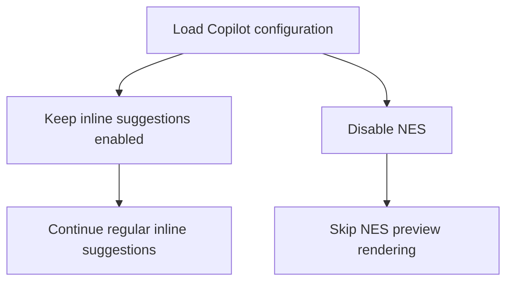

# Disable Copilot NES highlighting crash

The pinned `copilot-lsp` implementation asserts that Tree-sitter highlight
captures start at or after the previous capture's end. Overlapping captures
can violate that assumption while rendering a Next Edit Suggestion (NES).
Keep regular Copilot inline suggestions enabled, but disable NES until the
renderer handles overlapping captures safely.

## Assertions

- [ ] Given the Copilot configuration is loaded, expect inline suggestions
  enabled and NES disabled so a Next Edit Suggestion cannot reach the failing
  preview renderer.
